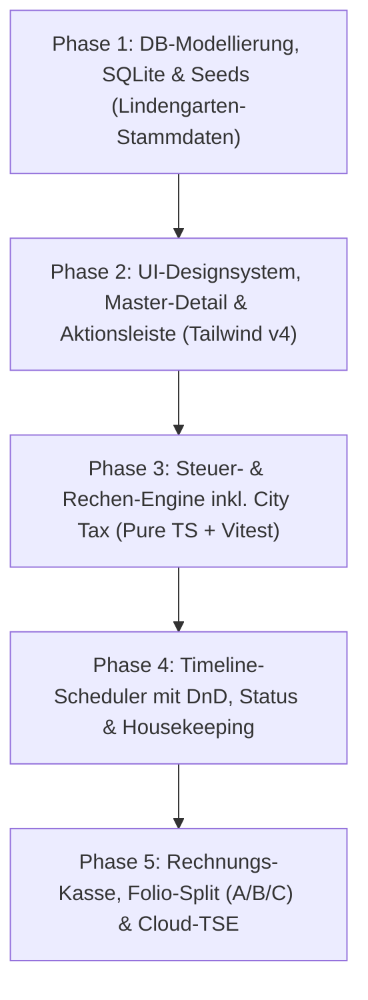

# Workpaper: Modernisierung der Hotelsoftware Lindengarten
**Status:** In Planung / Arbeitsgrundlage  
**Zielumgebung:** Web-basiertes Desktop-Pendant (React 19 + TypeScript + Tailwind CSS v4 + SQLite/Drizzle ORM)  
**Letzte Aktualisierung:** 13. Oktober 2026  
**Referenzsystem:** ELAN Hotelsoftware (hogatec.it) – Legacy Desktop-System  

---

## 1. Executive Summary & Projektvision

### 1.1 Ausgangslage & Zielsetzung
Die bestehende Legacy-Hotelsoftware für das Hotel Lindengarten (über 20 Jahre im produktiven Einsatz) besticht durch extreme Effizienz, maximale Tastaturbedienbarkeit, hohe Datendichte und unkomplizierte Arbeitsabläufe an der Rezeption. Ziel ist **kein** radikaler Paradigmenwechsel zu verspielten Web-Apps, sondern ein **moderner, webbasierter Nachbau**, der den Look-and-Feel, die Arbeitsgeschwindigkeit und das Master-Detail-Bedienmodell einer klassischen Windows-Desktop-Anwendung exakt bewahrt und auf aktuellen Webtechnologien abbildet.

### 1.2 Kernprinzipien des Projekts
1. **Desktop-Ergonomie im Web:** Feste Struktur, Master-Detail-Splitscreen, keine störenden Außen-Scrollbars, maximale Übersicht.
2. **Kompromisslose Tastatursteuerung:** Alle Rezeptions-Standardvorgänge (Gäste suchen, Buchung erfassen, Rechnungsstellung, Folio-Split) müssen vollständig über Hotkeys, Pfeiltasten und Tabulator ohne Mauszwang bedienbar sein.
3. **Schlanker Technologie-Stack:** Minimaler Overhead, kein schwerfälliges DB-Cluster, keine überladenen UI-Frameworks.
4. **Rechtliche & Fiskalische Präzision:** Vollständige Konformität mit deutschem Steuerrecht (USt-Splitting 7%/19%, Leipziger Beherbergungssteuer), Bundesmeldegesetz (Meldescheine), KassenSichV (Cloud-TSE Fiskaly V2) und E-Rechnungsstandards (ZUGFeRD / XRechnung ab 2025).

---

## 2. Analyse der Referenzbilder (Legacy-System ELAN / hogatec)

Die Auswertung der visuellen Referenzen aus dem Produktionsbetrieb des Hotels Lindengarten liefert das exakte architektonische und funktionale Profil des Systems:

```
referenzbilder/
├── 01_Timeline_Zimmerbelegungsplan.jpg          # Zentraler Zimmerbelegungsplan (Timeline)
├── 02_Reservierungsmaske_Buchungsdetails.jpg    # Buchungs- & Gastdetails mit F&B-Matrix
├── 03_Buchungsstatus_CheckIn_Schnittstellen.jpg # Buchungsflags, Check-In/Out & Schnittstellen
├── 04_Rechnungsuebersicht_Folio_Split.jpg       # Rechnungslegung & Folio-Split (A, B, C)
├── 05_Preisvarianten_Auswahl.jpg                # Preisstammdaten & Belegungsvarianten
└── 06_Stammdaten_Anreden_Aktionsleiste.jpg      # Anredenstamm & Referenz der Aktionsleiste
```

### 2.1 Bild 01: Timeline / Zimmerbelegungsplan (`01_Timeline_Zimmerbelegungsplan.jpg`)
* **Stammdaten der Zimmer des Hotels Lindengarten:**
  * Nummerierte Zimmer: `1`, `2`, `4`, `5`
  * Zimmer mit Namen: `Tobias`, `Annie`, `Herman`
  * Trennlinie `------` (Gebäudeteile / Kategorietrennung)
  * Suiten & Ferienwohnungen/Stuben: `Prinze` (Prinzessin von Sachsen Stube), `Stall`, `Scheun` (Scheune), `Schupp` (Schuppen), `Heubod` (Heuboden), `Kammer`, `Luisa`.
* **Achsen & Zeitraster:**
  * Y-Achse: Zimmer mit Kategoriefilter oben (`Kategorie: SUITE 120` / `Alle Zimmer`).
  * X-Achse: Tage mit Wochentagen. **Wochenenden (Samstag & Sonntag) sind signalrot hinterlegt** (`10.10 Sam`, `11.10 Son`).
  * Kalenderwochen-Indikator oben (`41 | Samstag 10. Oktober 2026 > ... | 42`).
  * Roter Richtungszeiger auf dem aktuellen Rezeptionsdatum.
* **Visuelle Buchungs- und Hauswirtschafts-Zustände:**
  * Buchungsblöcke mit dynamischer Namenswiederholung (z. B. `Hanse Touristik Hamburg GmbH-Hanse`).
  * Housekeeping-Status: `Dirty-Dirty-Dirty-` (Zimmer schmutzig) und Sonderstatus wie `Keine Wäsche-Keine Wäsche-Ke` (kein Bettwäschewechsel).
  * Statusanzeige `r` (Magenta): Vorreserviert / nicht eingecheckt.
  * Farbstatus: Orange/Grau (Standardbuchung), Blau (Sonderbuchung), Grün (Verfügbarkeiten/Kontingente).
* **Live-Statuszeile & Tooltips:**
  * Selektierter Zimmerblock wird gelb auf rot hervorgehoben (z.B. Zimmer `Herman`).
  * Untere Statuszeile zeigt bei Klick/Fokus sofort:  
    `Reser Reservierung auf : 18506 Junghans (5Ü/3P.(GPr.:830)/Z:Herman)`  
    *(Format: Res-Nr, Name, Nächte, Personen, Gesamtpreis, Zimmer)*.
  * Floating-Card `Buchungsinfo`: Personenaufschlüsselung (`2 Erw und 1 Kind 11 Jahre`), Verpflegungsangebot (`Angebot F/ 2 Gang`), Mitreisende (`Aline, Torsten und Lea`).
* **Untere Kalender-Aktionsleiste:**
  `[Reservieren]` `[CheckIn/Out]` `[Adresstamm]` `[Rechnung]` `[Reserv. Info]` `[Belegung]` `[Löschen]` `[Kopieren]` `[Drucken]` `[Beenden]`.

---

### 2.2 Bild 02: Reservierungsmaske (`02_Reservierungsmaske_Buchungsdetails.jpg`)
* **Registerkarten:** `Buchung` | `Mehr` | `Info` | `Zusatz`.
* **Kopfbereich Zimmer:**
  * Zimmer-Code (`Prinze`) & Langname (`Prinzessin von Sachsen Stube`).
  * Kategorie-Code (`TBZ`) & Bezeichnung (`Dreibettzimmer`).
  * Kapazitätsanzeige: `Betten: 2`, `Belegt: 0`, `Max: 4`.
  * Zeitraum: `Anreise`, `Abreise`, `Nächte`.
* **Gast- & Debitor-Information:**
  * Debitor/Gast mit Adressanzeige (`David`, `D 96264 Altenkunstadt`).
  * Stammgast-Status mit visueller Kennzeichnung (`Stammgast` in grüner Schrift).
* **Preisfindung & Verpflegung:**
  * Einzel- und Gesamtpreis mit Taschenrechner-Funktion.
  * Checkbox: `[X] Nicht Pauschal`.
  * Verpflegungsmatrix (F&B):
    * `Belegung: 1`
    * `Anz. Fr:` (Anzahl Frühstück, z.B. 1)
    * Mahlzeiten-Matrix: `Mt` (Mittag), `KT` (Kaffee/Tee), `Ab` (Abendessen), `TP` (Tagespauschale) mit Zyklus (`täglich`).
  * Steuerausweis: `MwSt. Schl.: 2`, `MwSt. Satz: 7,00 %`.

---

### 2.3 Bild 03: Buchungsstatus & Schnittstellen (`03_Buchungsstatus_CheckIn_Schnittstellen.jpg`)
* **Operative Buchungsflags:**
  * `Noch nicht Angereist` vs. `Angereist (Check-In)`.
  * `Noch nicht Abgereist` vs. `Abgereist (Check-Out)`.
  * `Schriftlich reserviert` (verbindlich vs. unverbindliche Option).
  * `nicht Fest (verlegbar)`: **Kritisches Flag für Drag-and-Drop!** Wenn `Fest`, darf das Zimmer im Kalender nicht versehentlich verschoben werden.
* **Peripherie- & Schloss-Schnittstellen (Vorlage-Relikt, entfällt laut Vorgabe):**
  * Keine Türschloss-/Keycard-Schnittstelle erforderlich (wurde aus System entfernt).

---

### 2.4 Bild 04: Rechnungslegung & Folio-Split (`04_Rechnungsuebersicht_Folio_Split.jpg`)
* **Suchfilter:** `Nach Debitor` | `nach Rechnungsnummer`.
* **Rechnungspositionen-Tabelle:**
  * Spalten: `RechNr`, `Debitor`, `Leistung`, `Zim-Nr`, `Anzahl`, `EPreis`, `GPreis`, `R`, `Datum von`, `Datum bis`, `Zeit`, `MwSt`, `MwStSch`, `Rechnungsdatum`, `Info`.
  * Steuerzuordnung je Zeile: Übernachtung 7 % (Schlüssel 2) vs. Parkplatz 19 % (Schlüssel 1).
* **Dreifach-Folio-Splitting (Konten A, B, C):**
  * Hotelspezifisches Splitting von Rechnungen:
    * **Konto A:** Firmenübernahme (z.B. Übernachtung 450,00 €, Debitor Hanse Touristik Hamburg GmbH).
    * **Konto B:** Privatauslagen des Gastes (z.B. Parkplatz 25,00 €).
    * **Konto C:** Weiteres Unterkonto für Nebenkosten oder Dritte.
  * Eigene Zahlungsart je Folio (`ZA: BAR / EC / KREDITKARTE`).
  * Umbuchung von Zeilen zwischen A, B und C per Schnellbutton.
  * **Ampel-Zahlungsstatus & Filter:**
    * **Grün:** Vollständig bezahlt (alle Rechnungen bezahlt).
    * **Gelber visueller Punkt (Ampel):** Teilbezahlt (mindestens 1 Rechnung bezahlt, mindestens 1 Rechnung offen).
    * **Rot:** Vollständig offen (keine Rechnung bezahlt).
    * **Filteroptionen linke Spalte:** `Alle`, `Offen`, `Teilbezahlt` (Filter auf Buchungen mit gelbem Ampelpunkt), `Bezahlt`, `Freie Kasse`.
* **Rechnungsaktionen:**
  * `Sofortdruck (F6)`, `Detaildruck`, `Vorschau`, `Zahlungsart`, `Storno`, `Debitor wechseln`, `+ Weitere Rechnung schreiben (F8)`.

---

### 2.5 Bild 05: Preisvarianten (`05_Preisvarianten_Auswahl.jpg`)
* **Preisvarianten-Definitionen:**
  * `Doppelt belegt` (Nr. 1)
  * `Einfach belegt` (Nr. 2)
  * `Dreifach belegt` (Nr. 3)
  * `ohne F&B 1 Person` (Nr. 5)
  * `ohne F&B 2 Personen` (Nr. 6)
  * `Online` (Nr. 7)
* Kennzeichnung `Pauschal: J/N`.

---

### 2.6 Bild 06: Stammdaten & Aktionsleiste (`06_Stammdaten_Anreden_Aktionsleiste.jpg`)
* **Anredenstamm:**
  * Tabellarische Zuordnung von Anrede, Adresstext, Brieftext und Code (z.B. Herr -> "Sehr geehrter Herr", Frau -> "Sehr geehrte Frau", Familie -> "Sehr geehrte Familie", Firma -> "Sehr geehrte Damen und Herren", Doktoren- und Professorentitel).
* **Standard-Aktionsleiste (Design & Funktionsfolge):**
  * `[Wählen]` (Grüner Haken)
  * `[Einfügen]` (Grünes Plus)
  * `[Kopieren]` (Doppeldokument)
  * `[Ändern]` (Lila Stift/Box)
  * `[Löschen]` (Rotes Minus)
  * `[Beenden]` (Power-Icon)
  * `[Hilfe]` (Fragezeichen)

---

## 3. Technologie-Stack & Architektur

| Schicht | Technologie / Bibliothek | Begründung & Rolle |
| :--- | :--- | :--- |
| **Frontend Framework** | **React 19 + TypeScript (TSX)** | Typsichere Komponentenarchitektur, optimiert für KI-gestützte Entwicklung. |
| **Styling & Layout** | **Tailwind CSS v4** | Schlanker Utility-First-Ansatz, reines CSS-Grid für Desktop-Frames und Split-Screen. |
| **Scheduler Drag & Drop** | **@dnd-kit/core** | Schnelle DnD-Engine mit `pointerIntersection` und Kollisionserkennung. |
| **Virtualisierung** | **@tanstack/react-virtual** | Flüssiges Scrolling im Zimmerbelegungsplan bei vielen Zimmern/Monaten. |
| **Backend & API** | **Node.js (TypeScript) / Vite Fullstack** | Kompakte REST-Endpoints, schnelle Reaktionszeiten. |
| **Datenbank & ORM** | **SQLite (better-sqlite3 / LibSQL) + Drizzle ORM** | Dateibasierte Datenbank, typsicheres Drizzle-Schema ohne Server-Overhead. |
| **PDF-Erzeugung** | **@react-pdf/renderer** oder **pdf-lib** | Meldescheine & Rechnungsbelege mit 1-Klick-Generierung. |
| **Cloud-TSE** | **Fiskaly SIGN DE API V2** | KassenSichV-Fiskalisierung mit **2,5s-Timeout-Offline-Fallback**. |
| **E-Rechnung** | **ZUGFeRD 2.0.1+ / Factur-X / EN 16931** | Hybride PDF/A-3 Rechnungen mit eingebettetem XML. |

---

## 4. Erweitertes Datenmodell (Drizzle ORM)

Basierend auf der Analyse der Referenzbilder umfasst das Schema nun alle realen Felder:

```typescript
// db/schema.ts
import { sqliteTable, text, integer, real } from 'drizzle-orm/sqlite-core';

// 1. Gäste / Adressstamm
export const guests = sqliteTable('guests', {
  id: integer('id').primaryKey({ autoIncrement: true }),
  guestNumber: text('guest_number').unique(),      // Gastnr.
  searchName: text('search_name'),                 // Suchname für Schnellsuche
  titleCode: integer('title_code').default(1),     // AnredeNr (1=Herr, 2=Frau, 3=Familie, 4=Firma)
  salutation: text('salutation'),                  // Briefanrede (z.B. "Sehr geehrter Herr")
  lastName: text('last_name').notNull(),           // Name
  firstName: text('first_name').notNull(),         // Vorname
  name2: text('name_2'),                           // Name 2 / Firma
  firstName2: text('first_name_2'),                // Vorname 2
  careOf: text('care_of'),                         // zu Händen
  street: text('street'),                          // Straße
  houseNumber: text('house_number'),               // Hausnummer
  zipCode: text('zip_code'),                       // PLZ
  city: text('city'),                              // Ort
  country: text('country').default('Deutschland'), // Land
  phone: text('phone'),
  email: text('email'),
  fax: text('fax'),
  birthDate: text('birth_date'),                   // Geburtsdatum (ISO)
  nationality: text('nationality'),                // Staatsangehörigkeit (Meldeschein)
  idCardNumber: text('id_card_number'),            // Pass-/Ausweisnummer (für Ausländer)
  paymentMethod: text('payment_method'),           // Zahlungsart (BAR, EC, KREDIT)
  isRegularGuest: integer('is_regular_guest', { mode: 'boolean' }).default(false), // Stammgast
  isTaxExempt: integer('is_tax_exempt', { mode: 'boolean' }).default(false),       // Befreiung City Tax
  taxExemptReason: text('tax_exempt_reason'),      // Grund: beruflich, med., GdB >= 80, Minderjährig
  remarks: text('remarks'),                        // Bemerkung
  guestInfo: text('guest_info'),                   // Gastinfo
  createdAt: text('created_at').notNull(),
});

// 2. Zimmer & Kategorien (Original Lindengarten Zimmer)
export const rooms = sqliteTable('rooms', {
  id: integer('id').primaryKey({ autoIncrement: true }),
  roomCode: text('room_code').notNull().unique(),  // z.B. "1", "2", "Tobias", "Prinze", "Stall"
  name: text('name').notNull(),                    // z.B. "Prinzessin von Sachsen Stube"
  categoryCode: text('category_code').notNull(),   // z.B. EZ, DZ, TBZ, SUITE
  categoryName: text('category_name').notNull(),   // z.B. Dreibettzimmer, Suite 120
  baseBeds: integer('base_beds').notNull().default(2),
  maxCapacity: integer('max_capacity').notNull().default(4),
  basePrice: real('base_price').notNull(),         // Basispreis
  floor: text('floor'),                            // Etage / Gebäudeabschnitt
  sortOrder: integer('sort_order').default(0),     // Sortierung in der Y-Achse
  housekeepingStatus: text('housekeeping_status').default('clean'), // clean, dirty, maintenance
  specialCleaningNote: text('special_cleaning_note'), // z.B. "Keine Wäsche"
});

// 3. Reservierungen & Belegungen
export const reservations = sqliteTable('reservations', {
  id: integer('id').primaryKey({ autoIncrement: true }),
  reservationNumber: text('reservation_number').notNull().unique(), // z.B. "18506"
  guestId: integer('guest_id').notNull().references(() => guests.id),
  roomId: integer('room_id').notNull().references(() => rooms.id),
  arrivalDate: text('arrival_date').notNull(),     // YYYY-MM-DD
  departureDate: text('departure_date').notNull(), // YYYY-MM-DD
  nights: integer('nights').notNull(),
  
  // Personen & Mitreisende
  adultsCount: integer('adults_count').default(1),
  childrenCount: integer('children_count').default(0),
  companionNames: text('companion_names'),         // z.B. "Aline, Torsten und Lea"
  
  // Status-Flags (aus Bild 03)
  isArrived: integer('is_arrived', { mode: 'boolean' }).default(false),     // Eingecheckt
  isDeparted: integer('is_departed', { mode: 'boolean' }).default(false),   // Ausgecheckt
  isWrittenReservation: integer('is_written_reservation', { mode: 'boolean' }).default(true), // Schriftlich reserviert
  isLockedToRoom: integer('is_locked_to_room', { mode: 'boolean' }).default(false), // Fest gebucht (nicht verlegbar per DnD!)
  
  // Preisfindung & Variante
  priceVariant: text('price_variant').default('Doppelt belegt'), // Einfach, Doppelt, Dreifach, Online
  pricePerNight: real('price_per_night').notNull(),
  totalPrice: real('total_price').notNull(),
  isFlatRate: integer('is_flat_rate', { mode: 'boolean' }).default(false), // Pauschal J/N
  
  // Verpflegungsmatrix (F&B)
  hasBreakfast: integer('has_breakfast', { mode: 'boolean' }).default(true),
  breakfastCount: integer('breakfast_count').default(1),
  lunchCount: integer('lunch_count').default(0),
  coffeeTeaCount: integer('coffee_tea_count').default(0),
  dinnerCount: integer('dinner_count').default(0),
  dailyArrangement: text('daily_arrangement'),     // z.B. "Angebot F/ 2 Gang"
  
  billingDebitor: text('billing_debitor'),
  notes: text('notes'),
  createdAt: text('created_at').notNull(),
});

// 4. Rechnungen & Folio-Konten (A, B, C)
export const invoices = sqliteTable('invoices', {
  id: integer('id').primaryKey({ autoIncrement: true }),
  invoiceNumber: text('invoice_number').notNull().unique(), // z.B. "117799"
  reservationId: integer('reservation_id').references(() => reservations.id),
  guestId: integer('guest_id').notNull().references(() => guests.id),
  invoiceDate: text('invoice_date').notNull(),
  servicePeriodStart: text('service_period_start').notNull(),
  servicePeriodEnd: text('service_period_end').notNull(),
  
  // Betragsaufschlüsselung
  netLodging: real('net_lodging').notNull(),        // Netto 7%
  taxLodging: real('tax_lodging').notNull(),        // USt 7%
  netService: real('net_service').notNull(),        // Netto 19% (F&B, Parkplatz)
  taxService: real('tax_service').notNull(),        // USt 19%
  cityTaxAmount: real('city_tax_amount').notNull(), // Beherbergungssteuer Leipzig (0% USt)
  totalGross: real('total_gross').notNull(),        // Bruttogesamtbetrag
  
  paymentMethod: text('payment_method').notNull(),  // BAR, EC, KREDITKARTE, RECHNUNG
  isPaid: integer('is_paid', { mode: 'boolean' }).default(false),
  
  // Fiskalisierung (Fiskaly V2 / KassenSichV)
  tseTransactionId: text('tse_transaction_id'),
  tseSignature: text('tse_signature'),
  tseSignatureCounter: integer('tse_signature_counter'),
  tseSerialNumber: text('tse_serial_number'),
  tseTimestamp: text('tse_timestamp'),
  tseQrCodeData: text('tse_qr_code_data'),
  tseOfflineFallback: integer('tse_offline_fallback', { mode: 'boolean' }).default(false),
  
  // E-Rechnung / ZUGFeRD
  isZugferdGenerated: integer('is_zugferd_generated', { mode: 'boolean' }).default(false),
  zugferdXmlContent: text('zugferd_xml_content'),
  
  status: text('status').default('final'),          // draft, final, cancelled
  createdAt: text('created_at').notNull(),
});

// 5. Rechnungspositionen mit Folio-Zuordnung (A, B, C)
export const invoiceItems = sqliteTable('invoice_items', {
  id: integer('id').primaryKey({ autoIncrement: true }),
  invoiceId: integer('invoice_id').notNull().references(() => invoices.id, { onDelete: 'cascade' }),
  folioBucket: text('folio_bucket').default('A'),   // 'A', 'B', 'C' (Folio-Splitting!)
  positionNumber: integer('position_number').notNull(),
  description: text('description').notNull(),       // z.B. "Marion Langerwisch", "Parkplatz"
  roomCode: text('room_code'),                      // Zim-Nr (z.B. "4")
  quantity: real('quantity').notNull().default(1),
  unitPriceGross: real('unit_price_gross').notNull(),
  totalGross: real('total_gross').notNull(),
  taxRate: real('tax_rate').notNull(),              // 0.07, 0.19, 0.00
  taxCode: integer('tax_code').notNull(),           // 2 = 7%, 1 = 19%
  taxType: text('tax_type').notNull(),              // LODGING, SERVICE, CITY_TAX
  dateFrom: text('date_from'),
  dateTo: text('date_to'),
  infoNote: text('info_note'),                      // z.B. "Doppelt belegt FuB-Gr.: 2"
});

// 6. Preisvarianten-Stamm
export const priceVariants = sqliteTable('price_variants', {
  id: integer('id').primaryKey({ autoIncrement: true }),
  variantNumber: integer('variant_number').notNull().unique(),
  name: text('name').notNull(),
  shortCode: text('short_code').notNull(),
  isFlatRate: integer('is_flat_rate', { mode: 'boolean' }).default(false),
});

// 7. Anreden-Stamm
export const salutations = sqliteTable('salutations', {
  id: integer('id').primaryKey({ autoIncrement: true }),
  salutationNumber: integer('salutation_number').notNull().unique(),
  addressText: text('address_text'),
  letterGreeting: text('letter_greeting').notNull(),
  code: text('code'),
});
```

---

## 5. UI/UX & Interaktionskonzept

### 5.1 Timeline-Scheduler (Zimmerbelegungsplan)
* **CSS-Grid Matrix:**
  * Vertikale Y-Achse: Original Lindengarten Zimmer (Nummern 1, 2, 4, 5, Tobias, Annie, Herman, Prinze, Stall, Scheun, Schupp, Heubod, Kammer, Luisa).
  * Horizontale X-Achse: Tage mit **signalrot markierten Samstagen und Sonntagen**.
  * Rezeptions-Datumsindikator (roter Richtungsmarker am aktuellen Tag).
* **Interaktivität & Drag-and-Drop:**
  * Ziehen mit `@dnd-kit/core` unter Berücksichtigung von `isLockedToRoom` (wenn ein Gast fest gebucht ist, wird DnD gesperrt!).
  * Kollisionserkennung über `pointerIntersection` zur strikten Vermeidung von Doppelbelegungen.
* **Statusanzeigen & Housekeeping:**
  * Statusfarben: Orange (Standard), Blau (Gruppe/Sonderbuchung), Grün (Frei/Kontingent), Grau mit Aufdruck `Dirty` (Reinigung ausstehend), Text `Keine Wäsche` (Wäschewechsel entfällt).
  * Status-Buchstabe `r` (Magenta) für reservierte, noch nicht erschienene Gäste.
* **Schnellinfo-Bar & Floating Card:**
  * Live-Statuszeile unten bei Markierung: `Reser Reservierung auf: [Nr] [Name] ([Nächte]Ü/[Personen]P.(GPr.:[Betrag])/Z:[Zimmer])`.
  * Detail-Flyout mit Mitreisenden und Verpflegungsangebot.

### 5.2 Folio-Splitting (Rechnungskonten A, B, C)
* **Aufteilung in 3 Folio-Container:**
  * **Folio A:** Firmenübernahme (Logis)
  * **Folio B:** Privatauslagen Gast (Parkplatz, Minibar, Frühstück)
  * **Folio C:** Sonderposten / Dritte
* **Interaktion:**
  * Positionen können per 1-Klick zwischen Folio A, B und C verschoben werden.
  * Getrennte Zahlungsarten je Folio (`ZA: BAR / EC / KREDITKARTE`).
  * Getrennter Druck (`Sofortdruck [F6]`, `Detaildruck`).

### 5.3 Die Standard-Aktionsleiste & Hotkeys
* Einheitliche Leiste am unteren Rand mit Standard-Tastaturkürzeln:
  * `[F6] Wählen / Drucken`
  * `[F7] Einfügen / Neu`
  * `[F8] Kopieren`
  * `[F9] Ändern / Speichern`
  * `[Entf] Löschen / Stornieren`
  * `[Esc] Beenden / Abbrechen`
  * `[F1]` bis `[F5]` für Modulwechsel (Timeline, Gäste, Buchungen, Kasse, Einstellungen).

---

## 6. Berechnungs-Engine: Steuern, Pauschalen & Gästetaxe Kurort Jonsdorf

### 6.1 Gesetzliche Rechenregeln
1. **Logis:** 7 % USt $\to \text{Netto} = \frac{\text{Brutto}}{1.07}$
2. **Services / F&B:** 19 % USt $\to \text{Netto} = \frac{\text{Brutto}}{1.19}$
3. **Gästetaxe Kurort Jonsdorf (Satzung vom 05.05.2025 / 1. Änderung):**
   * **Tarif Erwachsene & Jugendliche ab 15 Jahren:** **2,90 €** je Person und Tag/Übernachtung (§ 4 Abs. 1 & Anlage S. 8).
   * **Tarif Kinder & Jugendliche 6 bis 14 Jahre:** **1,45 €** (50 % Ermäßigung gem. § 5).
   * **Kleinkinder bis 6 Jahre:** **kostenfrei (0,00 €)** gem. § 3 Abs. 1 a.
   * **Bemessung:** Nach der Zahl der Übernachtungen (Ankunfts- und Abreisetag gelten zusammen als 1 Tag gem. § 4 Abs. 1). Völlig unabhängig vom Zimmerpreis!
   * **Befreiungstatbestände (`isTaxExempt` gem. § 3 Abs. 1):**
     - Schwerbehinderte GdB $\ge$ 80 **mit Merkzeichen „B“** im Ausweis (§ 3 Abs. 1 e)
     - Begleitpersonen von Schwerbehinderten mit Vermerk „B“ (§ 3 Abs. 1 f)
     - Ausbildung ohne Zweitwohnung (§ 3 Abs. 1 b)
     - Bettlägerig mit ärztlichem Attest (§ 3 Abs. 1 g)
     - Kinder unter 6 Jahren
   * **Wichtiger Unterschied zu Leipzig (§ 2 Abs. 5):** Dienstreisende / berufliche Aufenthalte sind in Kurort Jonsdorf **ausdrücklich gästetaxepflichtig**! (Keine Befreiung für Geschäftsreisen).
   * **Steuerlicher Ausweis:** Auf Folio B (Gastkonto) separat als durchlaufende Gemeindeabgabe (0 % USt).

---

## 7. Regulatorische Compliance

| Anforderung | Vorgabe | Technische Lösung |
| :--- | :--- | :--- |
| **Meldeschein** | Bundesmeldegesetz (BMG), DSGVO | 1-Klick-PDF-Export mit Passdaten für Ausländer, Vor-Ort- oder digitale Unterschrift, 1-jährige Löschfrist. |
| **KassenSichV** | § 146a AO, DSFinV-TW | Fiskaly Cloud-TSE (API V2) mit Signatur, QR-Code und **2,5s-Timeout-Offline-Fallback** (Kasse darf niemals anhalten!). |
| **E-Rechnung** | Wachstumschancengesetz ab 2025 | ZUGFeRD 2.0.1+ (PDF/A-3 mit EN 16931 Factur-X XML) & unveränderliche GoBD-Archivierung. |

---

## 8. Modulare Umsetzungs-Roadmap



1. **Phase 1: Datenmodellierung & Seed-Daten** ✅ *(Erfolgreich abgeschlossen)*
   - [x] SQLite Initialisierung mit `@libsql/client` und Drizzle ORM (`lindengarten.db`).
   - [x] Einpflegen aller 14 realen Lindengarten-Zimmer, Preisvarianten, Anreden und Beispieldaten aus den Screenshots.
   - [x] Etablierung des Express REST-Servers für LAN-Client-Zugriff (Port 3001).
   - [x] Vite + React 19 + TypeScript + Tailwind CSS v4 Client initialisiert und verifiziert.
2. **Phase 2: UI-Architektur & Master-Detail Views** ✅ *(Erfolgreich abgeschlossen)*
   - [x] Standardisierte Aktionsleiste (`ActionBar.tsx`) mit Tastenkürzeln (`[F6]` Wählen/Drucken, `[F7]` Neu, `[F8]` Kopieren, `[F9]` Ändern/Speichern, `[Entf]` Löschen, `[Esc]` Abbrechen).
   - [x] Globaler Keyboard-Shortcut-Hook (`useKeyboardShortcuts.ts`) für `F1`–`F5` Modulwechsel und Pfeiltastennavigation.
   - [x] System-Header (`Header.tsx`) mit Datums-/Uhrzeitsynchronisation, `Angemeldet: CHEF` und LAN-DB Online-Status.
   - [x] **Zimmerstamm-Maske** (`RoomsView.tsx`): 14 Lindengarten Zimmer, Schnellfilter (DZ, EZ, TBZ, SUITE, Dirty), Live-Housekeeping-Umschaltung per Doppelklick.
   - [x] **Gästestamm-Maske** (`GuestsView.tsx`): Adressverwaltung, Meldeschein-Felder (BMG: Ausweisnummer, Nationalität), Leipzig City-Tax Befreiungsprüfung (`isTaxExempt`), Stammgast-Kennzeichnung.
   - [x] **Buchungszentrale** (`ReservationsView.tsx`): Master-Detail aller Buchungen mit Filter (Im Haus, Reserviert, Anreisen/Abreisen heute), Status-Flags.
   - [x] **Reservierungsmaske** (`ReservationDialog.tsx`): Entspricht Bild 02 (Zimmerauswahl, Gast-/Debitorzuordnung, Nächte/Reisezeitraum, Preisvarianten, schlanke Verpflegungsmatrix mit Frühstück, OHP, 2Gang, 3Gang).
   - [x] **Status-Dialog** (`StatusDialog.tsx`): Entspricht Bild 03 (Check-In/Out, Schriftlich reserviert, Fest gebucht/gesperrt). Türschloss-Schnittstelle wurde komplett entfernt, da nicht Bestandteil der Vorgaben.
   - [x] **Stammdaten-Ansicht** (`MasterDataView.tsx`): Preisvarianten-Katalog (Bild 05) und Anreden-Katalog (Bild 06).
   - [x] **Rechnungs- & Folio-Split-Vorschau** (in `App.tsx`): 3 getrennte Folio-Container A (Logis), B (Gast), C (Sonderposten) als Vorbereitung für Phase 5.
3. **Phase 3: Steuer- & Abrechnungslogik** ✅ *(Erfolgreich abgeschlossen)*
   - [x] **Steuer-Engine** (`taxEngine.ts` in Client & Server):
     - USt-Splitting für Logis (7%) und Services/F&B (19%) nach § 12 UStG.
     - **Gästetaxe Kurort Jonsdorf (Satzung vom 05.05.2025)**: 2,90 € (ab 15 J.), 1,45 € (6–14 J., 50% Ermäßigung gem. § 5), 0,00 € (< 6 J. frei gem. § 3 Abs. 1 a), pro Person und Übernachtung. Befreiungsprüfung für GdB $\ge$ 80 mit Merkzeichen „B“, Begleitperson „B“, Ausbildung (§ 3). Dienstreisen bleiben steuerpflichtig (§ 2 Abs. 5).
     - **Dreifach-Folio-Splitting**: Aggregation und Steuerberechnung für Folio A (Logis/Firma), Folio B (Gastkonto/Auslagen inkl. Gästetaxe), Folio C (Sonderposten) mit Prüfsummen-Validierung (`totalGross === totalNet + totalTax`).
     - Dynamische Umbuchung von Zeilen zwischen den Folios A, B und C mit Live-Neuberechnung.
   - [x] **Kassen- & Folio-Ansicht** (`InvoicesView.tsx`): 3-Wege-Splitting-Container, Verschiebe-Buttons (`→ B`, `← A`, `→ C`), ZUGFeRD 2.0.1 / Factur-X EN 16931 XML-Vorschau mit Gästetaxe Kurort Jonsdorf (0%).
   - [x] **Live-Steueranzeige im Buchungsdialog** (`ReservationDialog.tsx`): Dynamische Netto/USt-Aufschlüsselung und Jonsdorfer Gästetaxe basierend auf Übernachtungen, Erwachsenen- und Kinderanzahl.
   - [x] **Vitest Testsuite** (`taxEngine.test.ts`): 33 Unit-Tests zu allen Rundungen, Jonsdorfer Satzungsregeln, Stornos, Rebooking und GoBD-Präzision (100% Erfolgsquote in < 20 ms).
4. **Phase 4: Interaktiver Timeline-Scheduler** ✅ *(Erfolgreich abgeschlossen)*
   - [x] **2D-Timeline Kalendermatrix** (`TimelineScheduler.tsx`):
     - Vertikale Y-Achse: Alle 14 Original Lindengarten Zimmer (1, 2, 4, 5, Tobias, Annie, Herman, Prinze, Stall, Scheun, Schupp, Heubod, Kammer, Luisa).
     - Horizontale X-Achse: Tage mit **signalrot markierten Samstagen und Sonntagen** (`Sa`/`So`) nach Bild 01 der ELAN hogatec Software.
     - Buchungsbalken mit Gastname, Nächteanzahl, Buchungsstatus (`[r]` Magenta für Reserviert, Haken für Im Haus) und Sperr-Icon 🔒.
   - [x] **Drag-and-Drop mit `@dnd-kit/core` & Kollisionserkennung**:
     - Buchungen können per DnD auf andere Zimmer verschoben werden.
     - **Buchungsschutz (`isLockedToRoom`)**: Wenn eine Buchung als fest gebucht markiert ist, wird DnD gesperrt (`disabled`).
     - **Kollisionserkennung**: Striktes Verhindern von Doppelbelegungen auf demselben Zimmer im selben Zeitraum mit Warnmeldung.
   - [x] **Schnellinfo-Bar am unteren Rand**:
     - Live-Statusanzeige: `Reser Reservierung auf: [Nr] [Gastname] ([Nächte]Ü/[Personen]P. (GPr.: [Betrag] €) / Z:[Zimmer])`.
   - [x] **Ansichts-Umschalter**:
     - 1-Klick-Wechsel zwischen **2D-Timeline (Belegungsplan)** und **Tabellarischer Buchungsliste** (`ReservationsView`).
5. **Phase 5: Kasse, Folio-Split (A/B/C) & TSE**
   - 3-Wege Folio-Splitting und Zahlungsart-Handling.
   - Fiskaly Cloud-TSE Anbindung mit Offline-Resilienz.
   - Meldeschein-PDF und ZUGFeRD 2.0.1 E-Rechnung.
6. **Phase 6: DIRS21 Channel Manager Schnittstelle (2-Wege Light)**
   - Lokales Polling (Pull) alle 2 Minuten in Express (`index.ts`) ohne externe Serverkosten (0,00 €).
   - "Zimmer-Tetris"-Lösung: Nullable `roomId` + Fallback-Zeile `⚠️ Nicht zugewiesen` im Kalender.
   - Buchungs-Lebenszyklus (`NEW`, `MODIFY`, `CANCEL`).
   - SQLite `sync_queue` für blockierungsfreies Verschieben im Frontend mit Hintergrund-Sync an DIRS21.

---

## 9. DIRS21 Channel Manager & OTA-Schnittstelle (2-Wege Light)

### 9.1 Architektur-Konzept: „2-Wege Light“
Statt einer hochkomplexen Enterprise-Schnittstelle mit Übertragung von Preisrastern, Saisonkurven und Restriktionen (ARI) wird das System auf das betriebliche Minimum reduziert:
* **Preise & Konditionen:** Verbleiben zu 100 % im DIRS21-Cockpit. Der Hotelier pflegt Sonderpreise, Rabatte und Saisonpreise direkt dort. Eingehende Buchungen liefern den fertigen Endpreis, der direkt in die Buchung übernommen wird.
* **Synchronisation (PMS $\leftrightarrow$ DIRS21):**
  * **Inbound:** Automatische Abholung neuer Online-Buchungen (Booking.com, Expedia, DIRS21 IBE) und Eintrag in den Kalender.
  * **Outbound:** Übertragung der reinen Anzahl freier Zimmer pro Kategorie und Tag an DIRS21 bei Vor-Ort-Buchungen oder Sperrungen an der Rezeption.

### 9.2 Lokale Pull-Architektur (0,00 € Serverkosten)
* **Kein gemieteter Cloud-Server, keine feste IP, kein Tunnel erforderlich:** Der lokale Express-Server (`index.ts`) auf dem Rezeptions-PC fragt alle 2 Minuten aktiv bei DIRS21 an (`OTA_ReadRQ` oder REST-GET).
* **Nachtruhe & Rechner-Ausfall:** DIRS21 hält neue Reservierungen in einer internen Server-Warteschlange (Queue), bis der Rezeptions-PC morgens startet, alle Buchungen gebündelt abholt und quittiert (`OTA_HotelResNotifRS`).
* **Überbuchungsschutz:** Findet zu 90 % direkt bei DIRS21 statt. Bucht ein Gast nachts um 02:00 Uhr auf Booking.com, sperrt DIRS21 sofort Expedia und die Hotel-Website, auch wenn der Rechner im Hotel ausgeschaltet ist.

### 9.3 Lösung für das „Zimmer-Tetris-Problem“
* **Problem:** Online-Portale buchen auf **Kategorie-Ebene** (z. B. 1x TBZ). Ist Kategorie TBZ vom 10.–15.10. frei, aber gestückelt (Zimmer *Prinze* 10.–12., Zimmer *Tobias* 12.–15.), findet ein automatischer Zuweiser kein durchgehend freies Einzelzimmer.
* **Lösung:**
  * Das Datenbankfeld `roomId` in `reservations` ist **optional (nullable)**.
  * Findet das Backend ein passendes, durchgehend freies Zimmer der Kategorie, wird es automatisch zugewiesen.
  * Findet es keines, wird die Buchung mit `roomId = null` angelegt.
  * In `TimelineScheduler.tsx` existiert eine feste oberste Zeile: **„⚠️ Nicht zugewiesen / Zuweisung prüfen“**.
  * Die Rezeptionistin sieht unzugeordnete Buchungen sofort und kann bestehende Buchungen per Drag-and-Drop verschieben, um die Lücke freizuschaufeln.

### 9.4 Buchungs-Lebenszyklus (New, Modify, Cancel)
* **Neu (`NEW`):** Gast & Buchung anlegen, Zimmer zuweisen oder in Unassigned-Zeile ablegen, Quittierung an DIRS21.
* **Änderung (`MODIFY`):** Bestehende Buchung anhand von `externalReservationId` lokalisieren. Prüfen, ob das bisherige Zimmer im neuen Zeitraum kollisionsfrei ist. Falls ja, Zeit anpassen; falls nein, auf `roomId = null` setzen.
* **Stornierung (`CANCEL`):** Buchungsstatus in SQLite auf `cancelled` setzen (GoBD-Historie bleibt gewahrt) und das Zimmer sofort im Kalender und in der DIRS21-Queue freigeben.

### 9.5 Entkoppelte Outbound-Queue (`sync_queue`)
* Beim Verschieben oder Anlegen von Buchungen im Kalender darf die UI niemals durch HTTP-Aufrufe an DIRS21 blockiert werden.
* Änderungen schreiben innerhalb von Millisekunden in eine lokale SQLite-Tabelle `sync_queue` (`category_code`, `date_from`, `date_to`, `status`).
* Ein schlanker Hintergrund-Worker (Node.js `setInterval` alle 15 Sekunden) aggregiert die geänderten Zeiträume, berechnet die verbleibende Verfügbarkeit und sendet ein gebündeltes Update an DIRS21 (inklusive Retry bei Internet-Schwankungen).

### 9.6 Frontend-Aktualisierung
* Statt ressourcenhungriger WebSockets: Schlankes Polling im Client alle 30 Sekunden (`useQuery` / `fetch`) plus automatischer Refetch beim Fokussieren des Rezeptions-Fensters (`window.onfocus`).

### 9.7 E-Mail-Vorlage für DIRS21-Schnittstellenanfrage

```text
An: support@dirs21.de
Betreff: Anfrage PMS-Schnittstelle (Pull-Abfrage & Verfügbarkeitsabgleich) – Hotel Lindengarten

Sehr geehrtes DIRS21-Team,

wir stellen im Hotel Lindengarten (Kundennummer / DIRS21-ID: [Ihre DIRS21-ID]) aktuell auf eine eigene, lokal im Haus betriebene Hotelsoftware (PMS) um und möchten diese über eine 2-Wege-Schnittstelle an DIRS21 anbinden.

Da unsere Software lokal auf dem Rezeptions-PC im Hotelnetzwerk läuft, möchten wir die Anbindung so schlank wie möglich über das Pull-Verfahren umsetzen:

1. Buchungsabruf (Inbound per Pull): Unser lokales System fragt in regelmäßigen Intervallen (z. B. alle 2 Minuten) aktiv bei DIRS21 ab, ob neue Reservierungen, Änderungen oder Stornierungen vorliegen (z. B. via OTA_ReadRQ oder REST-Abfrage), und bestätigt anschließend den Empfang. Ein externer Push/Webhook von außen in unser Hotelnetzwerk ist dadurch nicht erforderlich.

2. Verfügbarkeitsabgleich (Outbound): Sobald an unserer Rezeption Zimmer manuell gebucht, verschoben oder storniert werden, sendet unser System die aktualisierte Anzahl freier Zimmer pro Kategorie und Zeitraum per HTTPS-Request an DIRS21 (z. B. via OTA_HotelAvailNotifRQ). Die Pflege sämtlicher Preise, Raten und Restriktionen verbleibt weiterhin direkt im DIRS21-Cockpit.

Bitte teilen Sie uns hierzu kurz mit:
1. Welche Schnittstellenvariante (OTA-XML Webservice oder JSON/REST-API) Sie für diesen Anwendungsfall (Pull-Abruf + Verfügbarkeits-Update) empfehlen und freischalten können.
2. Wie wir die technische Schnittstellendokumentation sowie die Zugangsdaten (Endpunkt-URLs, API-Key / Zugangsdaten für Test- und Produktivsystem) erhalten.
3. Welche aktuellen Kategorie-Codes (Room Type IDs) in unserem DIRS21-Account hinterlegt sind, damit wir die Zuordnung vorab einrichten können.
4. Ob für die Freischaltung dieser Schnittstelle einmalige oder monatliche Gebühren anfallen.

Vielen Dank im Voraus für Ihre Unterstützung und Rückmeldung.

Mit freundlichen Grüßen
[Name Rezeption / Hotelier]
Hotel Lindengarten
```

### 9.8 Konkrete nächste Umsetzungsschritte (Arbeitsgrundlage für morgen)

* **Aktueller Status:** Schnittstellenanfrage an den DIRS21-Support vorbereitet.
* **Sobald DIRS21 rückmeldet, welches Format (REST oder OTA-XML) freigeschaltet wird, bauen wir als Erstes:**
  1. **Unzugewiesene Zeile im Kalender (`TimelineScheduler.tsx`):**
     - Integration einer festen Posteingangszeile ganz oben: `⚠️ Nicht zugewiesen / Zuweisung prüfen`.
     - Unterstützung für Reservierungen mit `roomId = null` im 2D-Scheduler inklusive Drag-and-Drop zur manuellen Zuordnung auf ein freies Zimmer.
  2. **Abfrage-Worker im Express-Backend (`server/src/index.ts`):**
     - Einrichtung des 2-Minuten-Polling-Intervalls (`setInterval`).
     - Format-Parser (JSON oder XML) für eingehende Reservierungen.
     - First-Fit Zimmerzuweisung mit Fallback auf `roomId = null`.
     - Senden der Empfangsbestätigung an DIRS21 (`OTA_HotelResNotifRS` bzw. HTTP 200).
  3. **Datenbankerweiterung (`server/src/db/schema.ts`):**
     - `roomId` in der Tabelle `reservations` auf `nullable` umstellen.
     - Felder `externalReservationId`, `channelSource` und die Tabelle `sync_queue` ergänzen.


